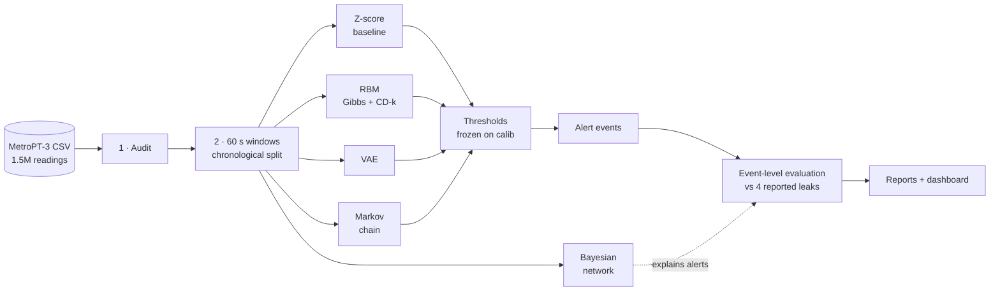

<div align="center">

# 🚇 MetroGuard

### Teaching a metro train's air compressor to tell us when something looks wrong

Unsupervised anomaly detection on **1.5 million real sensor readings**, built from scratch with an RBM,
a VAE, a Markov chain and a Bayesian network, and evaluated honestly against four reported air leaks.


### [🌐 Live dashboard](https://metroguard-compressor-anomaly-detec.vercel.app)

</div>

---

## 🎯 The problem

A metro train's **air production unit** (the compressor) feeds the train's pneumatic systems. When it starts
leaking or degrading, the train can be pulled out of service, and the first sign is usually buried in sensor data
nobody is watching.

The data exists. The labels almost don't:

- 📈 **1,516,948 readings** from 15 sensors (7 analog, 8 on/off), one every 10 seconds, over 213 days.
- 🏷️ **Four** company-reported air-leak intervals. Not a label per reading, just four time windows.
- 🔇 Failures are rare, so there is nothing to train a normal classifier on.

A maintenance team cannot read 1.5 million rows. They need the data to **speak up when it looks unusual**,
and to say *where* to look.

## 💡 What MetroGuard does

It learns what **normal** looks like from the first month, then scores how unusual every later minute is.

1. 🧹 **Audits** the raw file: cadence, gaps, frozen sensors, near-constant signals, motor-current states.
2. 🪟 **Windows** the data into 60-second chunks and splits it **by time**, never by shuffling.
3. 🧠 **Scores** each window with five approaches, from a simple z-score to a Bayesian network.
4. 🎚️ **Sets thresholds on held-out training data only**, freezes them, and only then touches the test period.
5. 🚨 **Merges alerts into events** and judges them at **event level** against the four reported leaks.
6. 🔎 **Explains** alerts: which sensor states look unusual together, without claiming a cause.
7. 🖥️ **Shows everything** in a dashboard, and lets anyone **run the same pipeline on their own file**, right in
   the browser.

## 🏗️ How it works



**The split is the heart of the design.** Nothing is ever fitted on data the model should not have seen:

```
 Feb 2020 (training month)                                     Mar ... Sep 2020
┌───────────────────────────┬────────────────┬────────────┐   ┌───────────────────────────┐
│ fit_train      72%        │ fit_validation │ calib 20%  │   │ test: everything later    │
│ model learns normal       │ early stopping │ thresholds │   │ scored only after the     │
│                           │ only           │ only       │   │ thresholds are frozen     │
└───────────────────────────┴────────────────┴────────────┘   └───────────────────────────┘
```

## 🧰 Concepts and techniques

| Idea | Where | Why it is here |
|---|---|---|
| **Restricted Boltzmann Machine**, written from scratch | `models/restricted_boltzmann_machine.py` | Gibbs sampling, contrastive divergence (k = 1, 5, 10) and free energy, with a brute-force test that proves the free-energy formula. No packaged RBM. |
| **Variational autoencoder** | `models/variational_autoencoder.py` | Reconstruction error and negative ELBO as anomaly scores, early stopping on a validation slice. |
| **Markov chain** over motor-current states | `models/markov_state_model.py` | Scores *transitions* between operating states, so it catches odd behaviour that averages hide. |
| **Bayesian network** | `models/bayesian_network.py` | Hill-climb structure search with BIC, BDeu parameters, d-separation and Markov-blanket reasoning to give each alert context. |
| **Z-score baseline** | `models/zscore_baseline.py` | The honest yardstick: if a deep model cannot beat this, we say so. |
| **Calibration thresholds** | `alerting/alert_thresholds.py` | Percentile of scores on held-out normal data, written to disk before any test scoring. |
| **Event-level evaluation** | `alerting/event_evaluation.py` | Four windows are intervals, not labels, so we score events detected, delay and *unconfirmed* alerts, not accuracy. |

## 📊 What we found

At the 99th-percentile threshold, on **206,857 test windows** over 184 days:

| Model | Windows flagged | Reported leaks detected | Unconfirmed alerts / day |
|---|---:|:---:|---:|
| Z-score baseline | 10.4% | 4 of 4 | 25.8 |
| RBM (k = 1 / 5 / 10) | 19.9 / 20.3 / 20.8% | 4 of 4 | 30.0 / 29.8 / 28.6 |
| VAE | 21.4% | 4 of 4 | 31.0 |
| **Markov chain** | **0.44%** | 3 of 4 | **3.6** |

What this teaches us, plainly:

- 🔍 **Detecting all four leaks is a weak result.** The detection ranges cover only **4.2%** of the test period,
  so any model that flags a tenth of all windows will overlap them by chance.
- 📉 **February is not representative of the rest of the year.** Thresholds set to flag about 1% of the training
  month flag 10-21% of later windows. Most of what the models detect is "different from February".
- 🥇 **No learned model beat the simple baseline.** The RBM and VAE flag about twice as many windows and detect no
  more events. They were also still improving when training stopped.
- 🎯 **The Markov chain is the most selective**, flagging a fraction of a percent while still finding three leaks.
- 🧊 **The data itself is messy:** 37.9 days with no readings, and 3.3% of readings sit in stretches where every
  sensor is frozen (excluded from scoring).

Every number comes from code that ran and saved its output. The full story, with limitations, is in
[`reports/final_report.md`](reports/final_report.md), and every decision with its reason is in
[`reports/decision_log.md`](reports/decision_log.md).

## 🛡️ Engineering principles

- ✅ **Real data only.** No synthetic or substitute data, ever.
- 🚫 **No leakage.** Scalers, bins, state boundaries, network structure and thresholds all come from training data.
- 🔒 **Frozen before test.** Each model's thresholds are written to disk, with a timestamp, before it sees a test window.
- 🗣️ **Honest wording.** Alerts outside reported windows are *unconfirmed alerts*, never "false alarms". No causal
  claims from the network, no prediction claims.
- ♻️ **Reproducible.** Fixed seed, every setting in `config.yaml`, one command per step, and a re-run reproduces every threshold and metric exactly.
- 🌱 **Efficient.** Raw CSV read once and cached, float32 tensors, GPU for the RBM and VAE, and each step skips
  work whose outputs are up to date.
- 🧪 **Tested.** 43 fast Python tests, including the brute-force RBM free-energy check, `ruff`-clean code, and
  13 Node tests for the in-browser pipeline.

## 🖥️ Dashboard

**Live:** <https://metroguard-compressor-anomaly-detec.vercel.app>

A static site (plain HTML, CSS and JavaScript) in [`dashboard/`](dashboard/README.md), built for Vercel:
a metro-line timeline of the whole record, interactive score charts with the reported leaks marked, the
learned Bayesian network, the metrics tables and a "what we can and cannot claim" page. A light theme with an optional pure-black dark
theme, keyboard-accessible charts, and responsive down to small phones.

```
python -m http.server 8000 --directory dashboard
```

### 📂 Analyse your own data

The **Analyse your data** page runs the whole pipeline on a visitor's own time-series file, **inside their
browser**. Nothing is uploaded: the file is read locally, the models train in a Web Worker, and the results are kept
in the browser until the visitor deletes them.

- 📄 **CSV, TSV, Excel or a PDF table.** Column roles (timestamp, sensor, on/off) and the timestamp format are
  detected, previewed and can be corrected.
- 🧭 **Same rules as the Python pipeline:** chronological split, everything fitted on the training windows,
  thresholds frozen on calib before any test window is scored, event-level evaluation against optional reported
  windows, and our own RBM (Gibbs sampling, CD-k, free energy), VAE, Markov chain and Bayesian network.
- 🔁 **Checked against Python.** On the full MetroPT-3 file (2 min 49 s in Chromium on a laptop) the browser reproduces the
  audit, the split, the z-score and Markov thresholds and every detection exactly, and the network reaches the same
  BIC score. The RBM and VAE flag 20.2-21.6% of windows against Python's 19.9-21.4%, because their random numbers
  come from a different generator (details in the decision log).
- 🧩 **Any sensors, not just MetroPT's.** Only a time column and numbers are needed. Before running, the page lists
  what will run with your columns; detectors that need something your file lacks are skipped with a reason, and
  sensors that are blank or constant in the training period are left out and named.
- ↩️ When no file is analysed, every page shows the MetroGuard results exactly as before, and a banner switches back.
- ✨ Motion and 3-D: GSAP scroll animation on the overview, a three.js view of the VAE's latent space, and a
  Lottie loader while an analysis runs, all skipped for visitors who prefer reduced motion.

```
node --test --disable-warning=MODULE_TYPELESS_PACKAGE_JSON "dashboard/tests/*.test.mjs"
```

## 🚀 Quick start

Requires Python 3.14. The RBM and VAE use the GPU when PyTorch can see one, otherwise the CPU.

```
py -3.14 -m venv .venv
.venv\Scripts\activate
pip install torch==2.9.1 --index-url https://download.pytorch.org/whl/cu128
pip install -r requirements-dev.txt
pip install -e .
```

Download `MetroPT3(AirCompressor).csv` from the
[UCI repository](https://archive.ics.uci.edu/dataset/791/metropt+3+dataset) into `data/raw/`, then:

```
python pipeline/step01_audit_raw_data.py
python pipeline/run_all_steps.py
```

Both skip finished work; add `--force` to recompute. The audit takes about a minute and steps 2 to 8 about two
minutes on a laptop GPU.

## 🗺️ Pipeline

| Step | Script | What it does |
|:--:|---|---|
| 1 | `step01_audit_raw_data.py` | Audits the raw file and writes the data audit report |
| 2 | `step02_build_features.py` | 60 s windows, chronological split, fit-only scaler, bins and state cut points |
| 3 | `step03_score_zscore_baseline.py` | Z-score baseline, thresholds frozen from calib |
| 4 | `step04_train_rbm.py` | RBM with contrastive divergence for k = 1, 5, 10 |
| 5 | `step05_train_vae.py` | VAE with early stopping on a validation slice |
| 6 | `step06_fit_markov_states.py` | Markov chain over motor-current states |
| 7 | `step07_build_bayesian_network.py` | Learns the network, runs the demos, explains two alerts |
| 8 | `step08_evaluate_alerts.py` | Event-level metrics and evaluation figures |
| 9 | *(written report)* | [`reports/final_report.md`](reports/final_report.md) |
| 10 | `step10_build_dashboard_data.py` | Exports saved results for the dashboard |

The scripts are thin; the logic lives in the library. File names that steps pass to each other are defined once in
`artifact_names.py`.

## 🗂️ Repository layout

```
config.yaml                every tunable value (seed, window size, model settings, thresholds)
src/metroguard/            library code, grouped by role
  data/                    loading, auditing, splitting and featurising the readings
  models/                  baseline, RBM, VAE, Markov chain, Bayesian network
  alerting/                thresholds, alert events, event-level evaluation
  reporting/               figures and the dashboard export
pipeline/                  one thin script per step, plus run_all_steps.py
tests/                     pytest, mirrors src/metroguard (no raw data needed)
dashboard/                 the static site, plus the in-browser pipeline (assets/analysis) and its tests
reports/                   audit report, decision log, final report, tables, figures
docs/                      project specification
data/  outputs/            raw and cached data, models, scores, logs (git-ignored, regenerable)
```

## 🔭 Limitations and what comes next

- Four reported events on one machine, so the results are exploratory and cannot support general conclusions.
- A one-month training period that does not represent the rest of the year. Training on a rolling window, or on
  several periods, is the obvious next experiment.
- The RBM and VAE were still improving at the configured epoch limits; longer training and a robust treatment of
  near-constant signals are untried.
- Reported windows are not dense labels: rows inside are not all faulty, and rows outside are not guaranteed normal.

## 🙏 Data and attribution

**MetroPT-3 Dataset**, UCI Machine Learning Repository, <https://doi.org/10.24432/C5VW3R>, licensed
CC BY 4.0. The raw file is not included in this repository.

Built by [@akshayparihardev](https://github.com/akshayparihardev) as a Deep Learning II course project.
