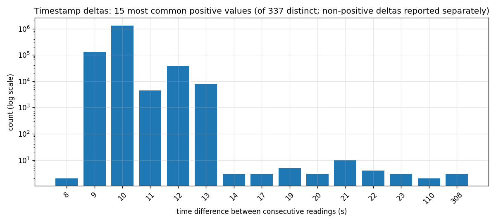
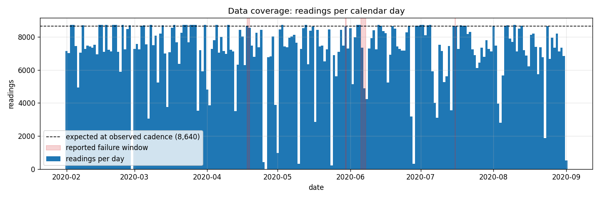
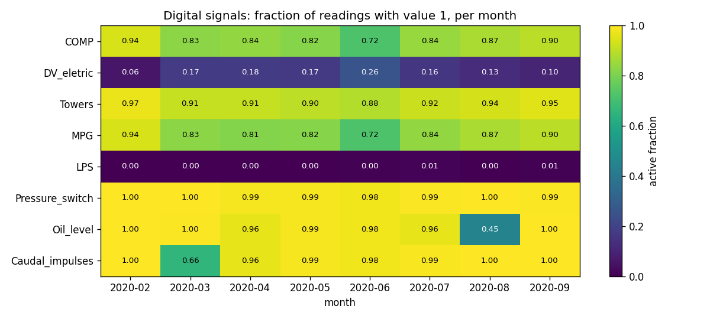
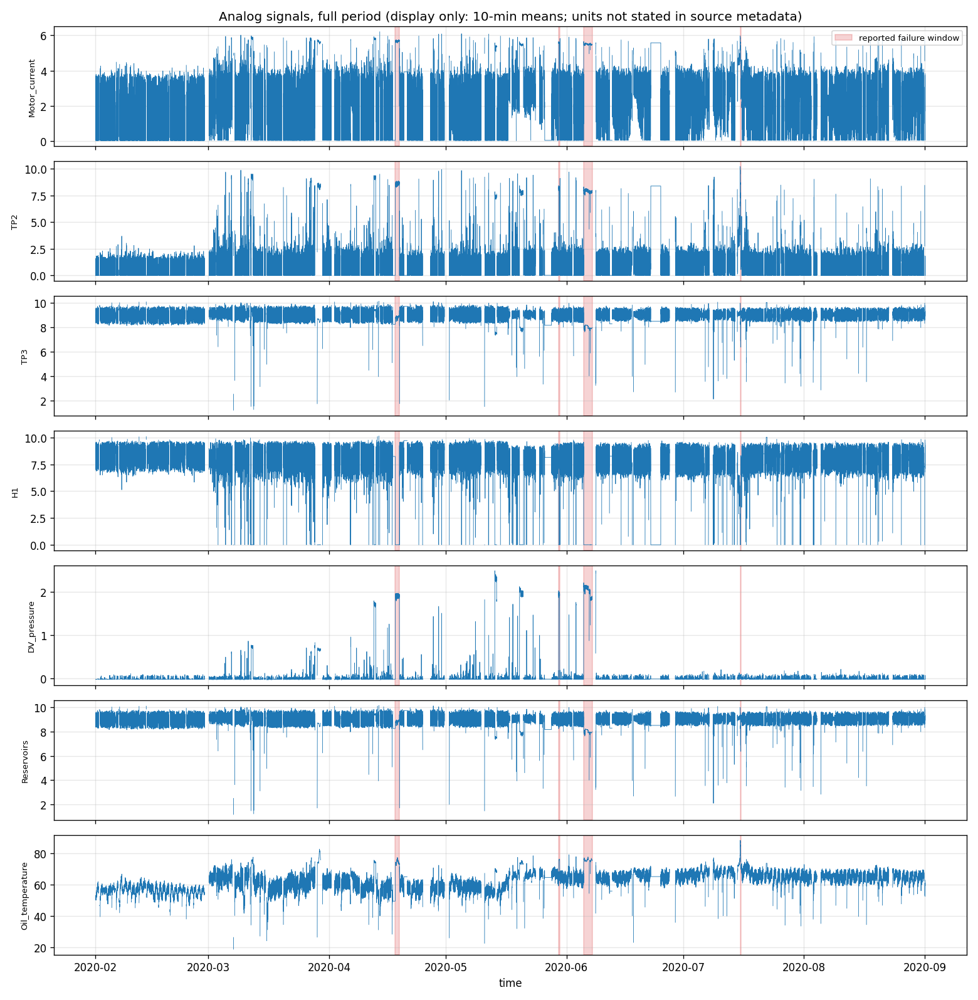
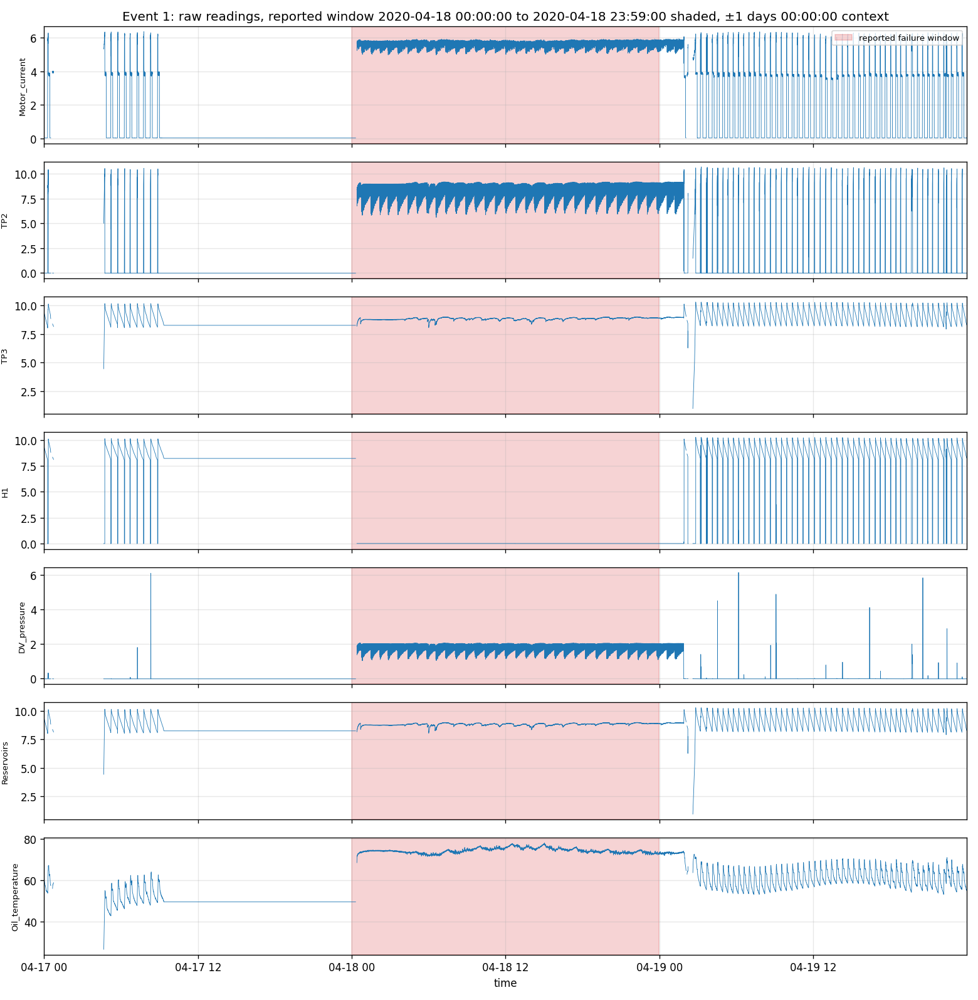
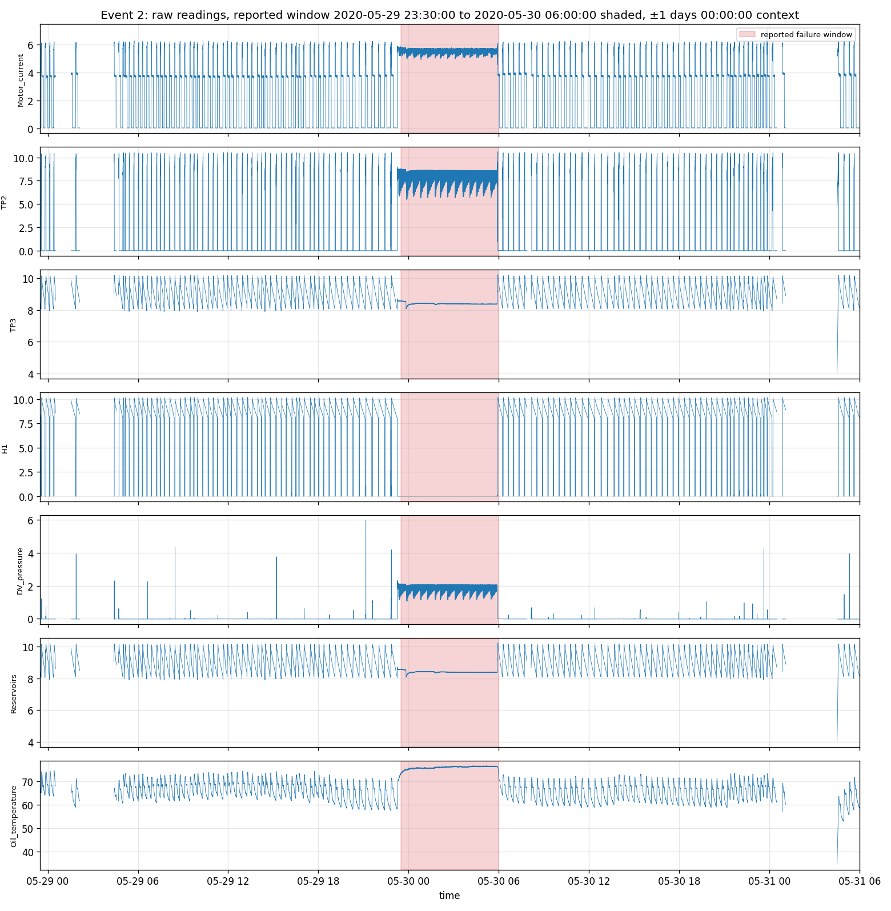
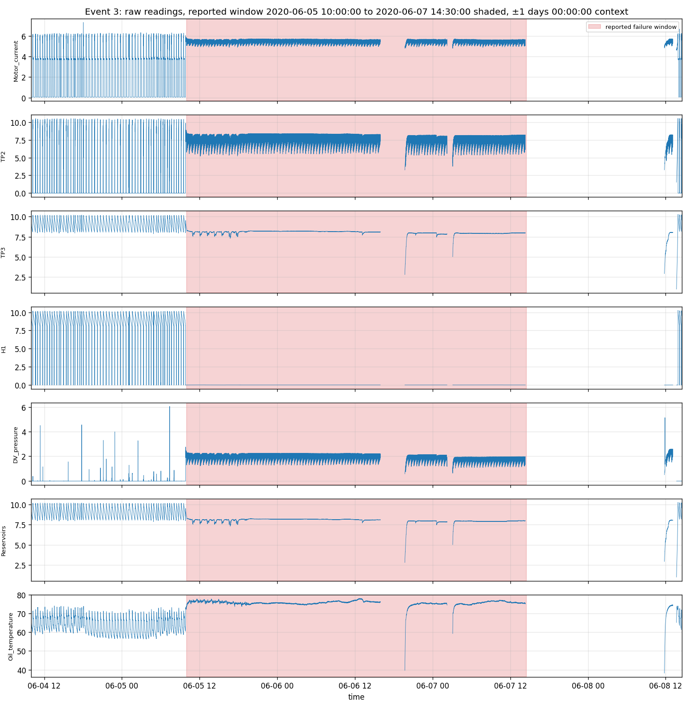
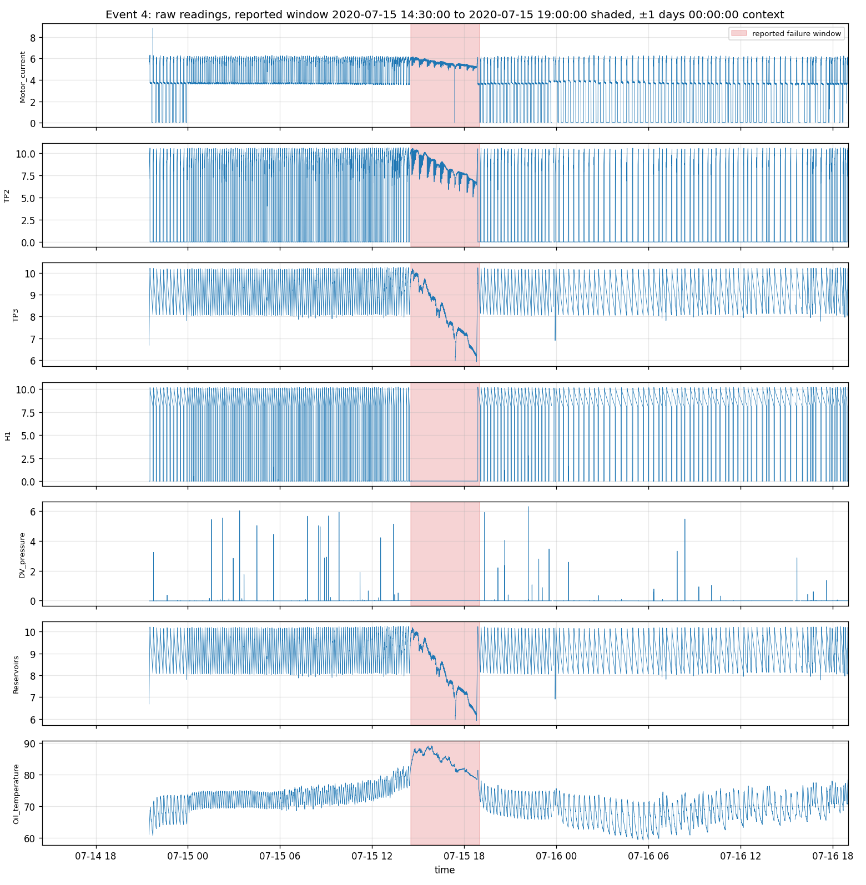
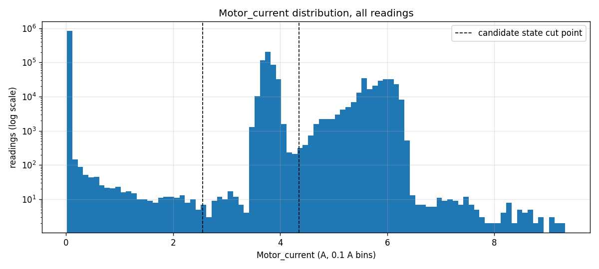
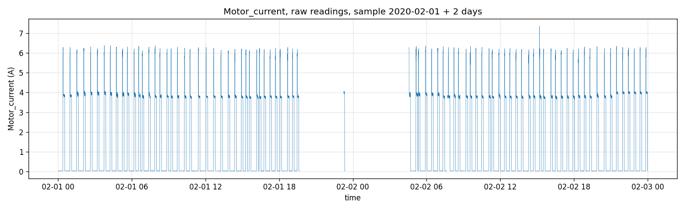

# MetroGuard: Step 1 Data Audit Report

Generated by `pipeline/step01_audit_raw_data.py`. Every number below was computed from the raw CSV in that run. **No model was trained and no detection-performance claim is made in this audit.**

## 1. Source, DOI, licence

- Dataset: MetroPT-3 (Air Compressor), UCI Machine Learning Repository, https://archive.ics.uci.edu/dataset/791/metropt+3+dataset
- DOI: https://doi.org/10.24432/C5VW3R
- Licence: CC BY 4.0. Attribution: MetroPT-3 Dataset, UCI Machine Learning Repository, https://doi.org/10.24432/C5VW3R.

## 2. File and schema

- File: `MetroPT3(AirCompressor).csv` (218.3 MB)
- Shape: 1,516,948 rows x 17 columns
- Timestamp column: `timestamp`
- Unnamed index column(s): `Unnamed: 0` (excluded from sensor analysis and from the parquet cache)
  - `Unnamed: 0`: 0 to 15,169,470, most common step 10.0, strictly increasing: True
- Analog sensors (7): TP2, TP3, H1, DV_pressure, Reservoirs, Oil_temperature, Motor_current
- Digital sensors (8 of 8 expected; matched by header name, verified by values): COMP, DV_eletric, Towers, MPG, LPS, Pressure_switch, Oil_level, Caudal_impulses
- Expected digital signals not found: none
- Columns outside the expected digital list whose values are strictly 0/1: none

Column dtypes as read and missing values:

| column | dtype | missing |
|---|---|---|
| Unnamed: 0 | int64 | 0 |
| timestamp | object | 0 |
| TP2 | float64 | 0 |
| TP3 | float64 | 0 |
| H1 | float64 | 0 |
| DV_pressure | float64 | 0 |
| Reservoirs | float64 | 0 |
| Oil_temperature | float64 | 0 |
| Motor_current | float64 | 0 |
| COMP | float64 | 0 |
| DV_eletric | float64 | 0 |
| Towers | float64 | 0 |
| MPG | float64 | 0 |
| LPS | float64 | 0 |
| Pressure_switch | float64 | 0 |
| Oil_level | float64 | 0 |
| Caudal_impulses | float64 | 0 |

First five rows:

| Unnamed: 0 | timestamp | TP2 | TP3 | H1 | DV_pressure | Reservoirs | Oil_temperature | Motor_current | COMP | DV_eletric | Towers | MPG | LPS | Pressure_switch | Oil_level | Caudal_impulses |
|---|---|---|---|---|---|---|---|---|---|---|---|---|---|---|---|---|
| 0 | 2020-02-01 00:00:00 | -0.012 | 9.358 | 9.34 | -0.024 | 9.358 | 53.6 | 0.04 | 1 | 0 | 1 | 1 | 0 | 1 | 1 | 1 |
| 10 | 2020-02-01 00:00:10 | -0.014 | 9.348 | 9.332 | -0.022 | 9.348 | 53.675 | 0.04 | 1 | 0 | 1 | 1 | 0 | 1 | 1 | 1 |
| 20 | 2020-02-01 00:00:19 | -0.012 | 9.338 | 9.322 | -0.022 | 9.338 | 53.6 | 0.0425 | 1 | 0 | 1 | 1 | 0 | 1 | 1 | 1 |
| 30 | 2020-02-01 00:00:29 | -0.012 | 9.328 | 9.312 | -0.022 | 9.328 | 53.425 | 0.04 | 1 | 0 | 1 | 1 | 0 | 1 | 1 | 1 |
| 40 | 2020-02-01 00:00:39 | -0.012 | 9.318 | 9.302 | -0.022 | 9.318 | 53.475 | 0.04 | 1 | 0 | 1 | 1 | 0 | 1 | 1 | 1 |

Last five rows:

| Unnamed: 0 | timestamp | TP2 | TP3 | H1 | DV_pressure | Reservoirs | Oil_temperature | Motor_current | COMP | DV_eletric | Towers | MPG | LPS | Pressure_switch | Oil_level | Caudal_impulses |
|---|---|---|---|---|---|---|---|---|---|---|---|---|---|---|---|---|
| 15169430 | 2020-09-01 03:59:10 | -0.014 | 8.918 | 8.906 | -0.022 | 8.918 | 59.675 | 0.0425 | 1 | 0 | 1 | 1 | 0 | 1 | 1 | 1 |
| 15169440 | 2020-09-01 03:59:20 | -0.014 | 8.904 | 8.888 | -0.02 | 8.904 | 59.6 | 0.045 | 1 | 0 | 1 | 1 | 0 | 1 | 1 | 1 |
| 15169450 | 2020-09-01 03:59:30 | -0.014 | 8.89 | 8.876 | -0.022 | 8.892 | 59.6 | 0.0425 | 1 | 0 | 1 | 1 | 0 | 1 | 1 | 1 |
| 15169460 | 2020-09-01 03:59:40 | -0.012 | 8.876 | 8.864 | -0.022 | 8.878 | 59.55 | 0.045 | 1 | 0 | 1 | 1 | 0 | 1 | 1 | 1 |
| 15169470 | 2020-09-01 03:59:50 | -0.014 | 8.86 | 8.848 | -0.022 | 8.864 | 59.475 | 0.0425 | 1 | 0 | 1 | 1 | 0 | 1 | 1 | 1 |

Numeric summary of sensor columns:

| statistic | TP2 | TP3 | H1 | DV_pressure | Reservoirs | Oil_temperature | Motor_current | COMP | DV_eletric | Towers | MPG | LPS | Pressure_switch | Oil_level | Caudal_impulses |
|---|---|---|---|---|---|---|---|---|---|---|---|---|---|---|---|
| count | 1.517e+06 | 1.517e+06 | 1.517e+06 | 1.517e+06 | 1.517e+06 | 1.517e+06 | 1.517e+06 | 1.517e+06 | 1.517e+06 | 1.517e+06 | 1.517e+06 | 1.517e+06 | 1.517e+06 | 1.517e+06 | 1.517e+06 |
| mean | 1.368 | 8.985 | 7.568 | 0.05596 | 8.985 | 62.64 | 2.05 | 0.837 | 0.1606 | 0.9198 | 0.8327 | 0.00342 | 0.9914 | 0.9042 | 0.9371 |
| std | 3.251 | 0.6391 | 3.333 | 0.3824 | 0.6383 | 6.516 | 2.302 | 0.3694 | 0.3672 | 0.2715 | 0.3733 | 0.05838 | 0.09214 | 0.2944 | 0.2428 |
| min | -0.032 | 0.73 | -0.036 | -0.032 | 0.712 | 15.4 | 0.02 | 0 | 0 | 0 | 0 | 0 | 0 | 0 | 0 |
| 25% | -0.014 | 8.492 | 8.254 | -0.022 | 8.494 | 57.78 | 0.04 | 1 | 0 | 1 | 1 | 0 | 1 | 1 | 1 |
| 50% | -0.012 | 8.96 | 8.784 | -0.02 | 8.96 | 62.7 | 0.045 | 1 | 0 | 1 | 1 | 0 | 1 | 1 | 1 |
| 75% | -0.01 | 9.492 | 9.374 | -0.018 | 9.492 | 67.25 | 3.808 | 1 | 0 | 1 | 1 | 0 | 1 | 1 | 1 |
| max | 10.68 | 10.3 | 10.29 | 9.844 | 10.3 | 89.05 | 9.295 | 1 | 1 | 1 | 1 | 1 | 1 | 1 | 1 |

## 3. Timestamps and cadence

- Parse failures with the explicit format `%Y-%m-%d %H:%M:%S`: 0
- Range: 2020-02-01 00:00:00 to 2020-09-01 03:59:50 (span 213 days 03:59:50)
- Timezone: not stated by the source. Assumption: timestamps and failure reports use the same local time.
- UCI metadata gives conflicting sampling rates (1 Hz in one field, 0.1 Hz in another). **The file itself shows a dominant interval of 10 s (0.1 Hz).**
- Positive deltas: min 8 s, median 10 s, mean 12.141 s, mode 10 s
- Zero deltas (duplicate timestamps after sorting): 0; negative deltas after sorting: 0

Most common positive deltas:

| delta_seconds | count | percent |
|---|---|---|
| 10 | 1337521 | 88.17 |
| 9 | 128277 | 8.456 |
| 12 | 38321 | 2.526 |
| 13 | 7988 | 0.5266 |
| 11 | 4471 | 0.2947 |
| 21 | 10 | 0.0006592 |
| 19 | 5 | 0.0003296 |
| 22 | 4 | 0.0002637 |
| 23 | 3 | 0.0001978 |
| 20 | 3 | 0.0001978 |

## 4. Missing values, duplicates, order, gaps

- Missing values: 0 in total (per column in section 2)
- Duplicate rows (all columns incl. index): 0; excluding the index column: 0
- Duplicate timestamps: 0
- File order: 0 backward and 0 zero timestamp steps before sorting (already in time order)

**Gap definition.** With the observed cadence c = 10 s: a delta equal to c is *normal*; a delta in (c, 20 s] is *jitter* (up to 2x cadence, not an error); a delta above 20 s is a *gap*; a delta of at least 1 h is a *long gap*.

| class | count | percent of deltas |
|---|---|---|
| normal (= cadence) | 1337521 | 88.172 |
| jitter | 179075 | 11.805 |
| gap | 351 | 0.023 |
| of which long gap | 160 | 0.011 |

Time without readings inside gaps: 37.90 days.

Ten longest gaps:

| gap_start | gap_end | duration_hours |
|---|---|---|
| 2020-04-25 01:10:51 | 2020-04-27 01:12:49 | 48.03 |
| 2020-06-27 10:53:07 | 2020-06-28 23:07:43 | 36.24 |
| 2020-02-28 23:57:08 | 2020-03-01 04:00:09 | 28.05 |
| 2020-08-04 07:42:28 | 2020-08-05 08:23:01 | 24.68 |
| 2020-05-24 00:39:23 | 2020-05-25 01:14:14 | 24.58 |
| 2020-07-07 15:24:51 | 2020-07-08 15:20:51 | 23.93 |
| 2020-08-22 19:11:44 | 2020-08-23 18:51:01 | 23.65 |
| 2020-05-10 00:31:17 | 2020-05-10 22:48:58 | 22.29 |
| 2020-06-07 14:19:39 | 2020-06-08 11:48:04 | 21.47 |
| 2020-04-01 13:15:40 | 2020-04-02 09:59:17 | 20.73 |

**Frozen-value runs.** Stretches of at least 60 min in which all analog sensors repeat exactly the same value from reading to reading. Readings exist, but the values do not change, which suggests repeated or stuck logging rather than real behaviour. They are reported, not removed.

| start | end | readings | duration_hours |
|---|---|---|---|
| 2020-04-17 09:20:33 | 2020-04-18 00:18:07 | 4470 | 14.96 |
| 2020-04-20 04:49:07 | 2020-04-21 01:16:52 | 6110 | 20.46 |
| 2020-05-26 09:19:26 | 2020-05-28 03:16:28 | 12449 | 41.95 |
| 2020-06-12 02:01:46 | 2020-06-12 17:06:06 | 4502 | 15.07 |
| 2020-06-22 15:06:11 | 2020-06-25 05:08:35 | 18515 | 62.04 |
| 2020-07-21 13:45:02 | 2020-07-21 22:03:16 | 2481 | 8.3 |
| 2020-07-22 06:43:34 | 2020-07-22 13:04:24 | 1898 | 6.35 |

Total readings in frozen runs: 50,425 (3.32% of rows).

## 5. Digital signals

| column | value_counts | strictly_binary | active_fraction | near_constant |
|---|---|---|---|---|
| COMP | {'0.0': 247328, '1.0': 1269620} | True | 0.8370 | False |
| DV_eletric | {'0.0': 1273310, '1.0': 243638} | True | 0.1606 | False |
| Towers | {'0.0': 121586, '1.0': 1395362} | True | 0.9198 | False |
| MPG | {'0.0': 253840, '1.0': 1263108} | True | 0.8327 | False |
| LPS | {'0.0': 1511760, '1.0': 5188} | True | 0.0034 | True |
| Pressure_switch | {'0.0': 12990, '1.0': 1503958} | True | 0.9914 | False |
| Oil_level | {'0.0': 145391, '1.0': 1371557} | True | 0.9042 | False |
| Caudal_impulses | {'0.0': 95406, '1.0': 1421542} | True | 0.9371 | False |

Near-constant flag: active fraction below 0.5% or above 99.5%. No column was recoded or dropped.

Active fraction per month:

| month | COMP | DV_eletric | Towers | MPG | LPS | Pressure_switch | Oil_level | Caudal_impulses |
|---|---|---|---|---|---|---|---|---|
| 2020-02 | 0.939 | 0.061 | 0.970 | 0.939 | 0.000 | 0.999 | 1.000 | 1.000 |
| 2020-03 | 0.828 | 0.172 | 0.914 | 0.827 | 0.002 | 0.996 | 0.996 | 0.658 |
| 2020-04 | 0.838 | 0.176 | 0.913 | 0.813 | 0.002 | 0.987 | 0.964 | 0.964 |
| 2020-05 | 0.817 | 0.171 | 0.902 | 0.817 | 0.004 | 0.987 | 0.988 | 0.988 |
| 2020-06 | 0.719 | 0.260 | 0.883 | 0.719 | 0.004 | 0.977 | 0.979 | 0.979 |
| 2020-07 | 0.845 | 0.158 | 0.920 | 0.838 | 0.009 | 0.994 | 0.963 | 0.989 |
| 2020-08 | 0.873 | 0.127 | 0.936 | 0.873 | 0.002 | 0.998 | 0.447 | 1.000 |
| 2020-09 | 0.896 | 0.104 | 0.951 | 0.896 | 0.008 | 0.992 | 1.000 | 1.000 |

## 6. Reported failure windows and coverage

Windows are treated as reported intervals, not dense labels. Boundaries are inclusive at both ends: [start, end].

| event | start | end | duration_hours | readings | expected_at_cadence | coverage_percent | largest_gap_seconds | fully_covered |
|---|---|---|---|---|---|---|---|---|
| 1 | 2020-04-18 00:00:00 | 2020-04-18 23:59:00 | 23.98 | 8657 | 8635 | 100.3 | 352 | False |
| 2 | 2020-05-29 23:30:00 | 2020-05-30 06:00:00 | 6.5 | 2360 | 2341 | 100.8 | 12 | True |
| 3 | 2020-06-05 10:00:00 | 2020-06-07 14:30:00 | 52.5 | 17315 | 18901 | 91.6 | 1.362e+04 | False |
| 4 | 2020-07-15 14:30:00 | 2020-07-15 19:00:00 | 4.5 | 1622 | 1621 | 100.1 | 139 | False |

- `expected_at_cadence` assumes one reading every 10 s. `fully_covered` means no gap above the gap threshold inside the window, counting from the window start to the first reading and from the last reading to the window end.
- Event 1 ends at 23:59:00 (minute precision). Under the inclusive rule, 6 readings between 23:59:00 and 00:00:00 fall outside the window. They are reported here; the window is not extended.
- Missing coverage inside a window is a property of the data file, not a model result; no model exists yet.

UCI metadata ambiguities (reported, not resolved):

- UCI numbers two events as "#1"; they are renumbered 1-4 here for convenience only.
- The maintenance note for event 2 reads "Maintenance on 30Apr at 12:00", which precedes the event (29-30 May). It may be a typo for 30 May; it is not corrected.
- The timezone of timestamps and reports is not stated (see section 3).

## 7. Candidate chronological split

| candidate | start | end | train rows | overlapping events | test rows | test rows in reported windows |
|---|---|---|---|---|---|---|
| first_calendar_month | 2020-02-01 00:00:00 | 2020-02-29 23:59:59 | 214850 | none | 1302098 | 29954 |
| first_30_days | 2020-02-01 00:00:00 | 2020-03-01 23:59:59 | 222113 | none | 1294835 | 29954 |

No train/test files were written and no scaler was fitted in step 1.

## 8. Motor current

- Unique values: 1,809

| quantile | Motor_current (A) |
|---|---|
| 0 | 0.02 |
| 0.01 | 0.035 |
| 0.05 | 0.0375 |
| 0.25 | 0.04 |
| 0.5 | 0.045 |
| 0.75 | 3.807 |
| 0.95 | 5.988 |
| 0.99 | 6.188 |
| 1 | 9.295 |

Most common values rounded to 0.1 A:

| Motor_current (A) | readings |
|---|---|
| 0 | 827967 |
| 3.8 | 174471 |
| 3.7 | 162248 |
| 3.9 | 69017 |
| 5.6 | 35270 |
| 6 | 33922 |
| 6.1 | 30178 |
| 5.9 | 29395 |
| 5.8 | 24183 |
| 3.6 | 23937 |

Candidate states from a transparent rule: peaks of a 0.1 A histogram smoothed over 5 bins, keeping peaks whose smoothed bin holds at least 0.5% of all readings; neighbouring peaks are merged unless the valley between them is below 50% of the lower peak; `peak_amps` is the most populated raw bin near each peak; cut points are the minima between peaks. Provisional only, not a final discretisation.

| state | peak_amps | lower_cut_amps | upper_cut_amps | share_of_readings |
|---|---|---|---|---|
| 0 | 0.05 | -inf | 2.55 | 0.547 |
| 1 | 3.75 | 2.55 | 4.35 | 0.295 |
| 2 | 5.95 | 4.35 | inf | 0.158 |

Share of readings within ±0.75 A of the hypothesised 0/4/7/9 A levels:

| level_amps | share_within_tolerance |
|---|---|
| 0.0000 | 0.5465 |
| 4.0000 | 0.2977 |
| 7.0000 | 0.0034 |
| 9.0000 | 0.0000 |

## 9. Caveats

- Failure windows are company-reported intervals; rows inside them are not uniformly faulty and rows outside them are not guaranteed normal.
- Sensor units are not stated in the CSV; plots label raw values.
- Visual observations, unanswered questions and step 2 recommendations are in section 11 and in `reports/decision_log.md`.

## 10. Statement

No model was trained, no threshold was chosen and no detection-performance or causal claim is made in this audit.

## 11. Analyst notes (written by hand, preserved on re-run)

Descriptive observations from the figures. They do not show that a failure was detected and they do not identify a cause.

**Visible patterns in the event windows** (`figures/data_audit/event*_zoom_analog_signals.png`):

- Events 1, 2 and 3: the regular cycle seen in the surrounding context (Motor_current switching between about 0 A, 3.8 A and 6 A, with TP3/Reservoirs oscillating between about 8 and 10) is replaced inside the window by a sustained pattern. Motor_current stays near 5.5 A, H1 stays near 0, DV_pressure stays near 1.5 to 2, Oil_temperature is raised (about 73 to 77) and TP3/Reservoirs sit almost flat around 8 to 8.5. The pattern starts and stops close to the reported window boundaries.
- Event 4 looks different: Motor_current stays near 5 to 6 A, TP3/Reservoirs fall steadily from about 10 to about 6, H1 is near 0, DV_pressure does not show the sustained level seen in events 1 to 3, and Oil_temperature rises to about 88 to 89 (the highest level in the full period). Oil_temperature is already rising in the hours before the window.
- In the full-period overview, sustained DV_pressure levels near 2 also appear outside the reported windows (for example mid-April and mid/late May). Whether these are unreported events or normal operation cannot be told from the data. Models will likely flag them, and step 8 must count them as unconfirmed alerts.

**Data quality notes that affect step 2:**

- No readings exist on 29 Feb 2020 (gap from 2020-02-28 23:57:08 to 2020-03-01 04:00:09). The first calendar month therefore covers 1 to 28 Feb in practice.
- There are 7 frozen-value runs (section 4). None of them falls in February. The first one (2020-04-17 09:20 to 2020-04-18 00:18) overlaps the first 18 minutes of event 1.
- Event 3: the largest internal gap is 13,620 s (about 3.8 h) and coverage is 91.6%. Event 1's largest gap is 352 s.
- Coverage above 100% for events 1, 2 and 4 is caused by 9 s jitter intervals (8.5% of deltas): more readings than one per 10 s.

**February versus later months** (training-period representativeness):

- Digital signals in February: Oil_level and Caudal_impulses are active 100% of the time, Pressure_switch 99.9% and LPS almost never. Within the training month these four are near-constant, even though Caudal_impulses (Mar 0.658) and Oil_level (Aug 0.447) vary later.
- Share of readings with Motor_current above 4.35 A (the high state): 6.1% in February, against 10.6% to 27.6% in later months. TP2 and DV_pressure are visibly calmer in February.
- So February does contain all three motor-current states, but in different proportions. Models trained on February will likely score later normal operation as unusual more often. That raises unconfirmed alerts; it is not a leak.

**Motor-current states.** The data supports three candidate states: about 0.05 A (idle, 54.7%), about 3.75 A (29.5%) and about 5.95 A (15.8%), with cut points at 2.55 A and 4.35 A. The hypothesised 7 A and 9 A states are not supported (0.34% and 0.00% of readings within ±0.75 A).

**Unanswered questions:** the timezone; whether the event 2 maintenance note "30Apr" is a typo; the cause of the frozen-value runs; whether the sustained high-DV_pressure periods outside the windows are unreported events.
